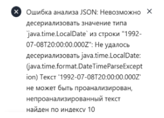

**Email:** [oxbanda@mail.ru](mailto:oksbanda@mail.ru) 

**Telegram:** @oksbanda

**Обо мне**   
Junior QA с техническим образованием (Информационные системы и технологии). В 2026 году прошла курсы по ручному тестированию, SQL и Postman.

**Стек:  Jira, TestRail, Postman, Swagger, Chrome DevTools, SQL, Charles Proxy**

### **Учебные проекты**

#### **Проект 1: Функциональное тестирование страхового портала**

**Информация о проекте:**

* Задача: Провести функциональное тестирование сценариев авторизации и выхода из системы (логин/логаут) для портала страховой компании.  
* Ссылка на продукт: [https\://demo.guru99.com/insurance/v1/index.php](https://demo.guru99.com/insurance/v1/index.php)  
* Цель тестирования: Проверить корректность работы и безопасность процессов аутентификации пользователя.

**Проделанная работа:**

1. **Тест-кейсы:** Разработан набор тест-кейсов для проверки позитивных и негативных сценариев логина и логаута.  
   [https\://docs.google.com/spreadsheets/d/1Kd5B0K8A0qQAi7zNi5FfplECweGqBJF39KMs5mQVHYs/edit?usp=sharing](https://docs.google.com/spreadsheets/d/1Kd5B0K8A0qQAi7zNi5FfplECweGqBJF39KMs5mQVHYs/edit?usp=sharing)  
2. **Баг-репорты:** Зафиксированы и оформлены обнаруженные дефекты.  
   [https\://docs.google.com/spreadsheets/d/1Kd5B0K8A0qQAi7zNi5FfplECweGqBJF39KMs5mQVHYs/edit?usp=sharing](https://docs.google.com/spreadsheets/d/1Kd5B0K8A0qQAi7zNi5FfplECweGqBJF39KMs5mQVHYs/edit?usp=sharing)

**Отчет о тестировании:** Составлен итоговый документ, содержащий цели, объем тестирования, статистику по дефектам и выводы.

[https\://docs.google.com/document/d/1eS3Zj27maIU6hQX1iHHN-oTtS9JIjHLRMzzBRhw5sVQ/edit?usp=sharing](https://docs.google.com/document/d/1eS3Zj27maIU6hQX1iHHN-oTtS9JIjHLRMzzBRhw5sVQ/edit?usp=sharing)

#### 

#### 

#### **Проект 2: Тестирование раздела "Пассажиры" для Kata Airways**

**Информация о проекте:**

* Задача: Комплексное функциональное тестирование CRUD-операций (создание, чтение, обновление, удаление) и пользовательского интерфейса раздела "Пассажиры".  
* Ссылка на продукт: [https\://kata-airways.netlify.app/](https://kata-airways.netlify.app/)  
* Цель тестирования: Проверить корректность ввода, валидации, редактирования, удаления данных, а также usability интерфейса.

**Проделанная работа:**

1. **Чек-лист:** Создан чек-лист для охвата ключевых функциональных элементов раздела.  
   [https\://docs.google.com/document/d/1Tq45Tja4viymH-Er0O57ColH1jjr972vNOrRpZ2pt6c/edit?usp=sharing](https://docs.google.com/document/d/1Tq45Tja4viymH-Er0O57ColH1jjr972vNOrRpZ2pt6c/edit?usp=sharing)  
2. **Тест-кейсы:** Разработаны детальные тест-кейсы для проверки всех заявленных функций.  
   [https\://docs.google.com/spreadsheets/d/1ePdoFWfMkViE0p3U-Wa-4U8-cxzuvkF4KJSBCdpy0DA/edit?usp=sharing](https://docs.google.com/spreadsheets/d/1ePdoFWfMkViE0p3U-Wa-4U8-cxzuvkF4KJSBCdpy0DA/edit?usp=sharing)  
3. **Баг-репорты:** Обнаружены, воспроизведены и зафиксированы критические дефекты.

**Баг №1** 

**Название**: Отсутствует кнопка “Сохранить” при редактировании данных

**Шаги:**

1. Открыть страницу  [https\://kata-airways.netlify.app/](https://kata-airways.netlify.app/)   
2. Ввести логин admin,пароль admin  
3. Нажать кнопку "Пассажиры"  
4. Открыть кебаб-меню у любого пассажира  
5. Нажать на кнопку "редактировать"   
6. Изменить данные в полях на валидные значения  
7. Нажать "сохранить" 

**Ожидаемый результат:**

1. При введение валидных значений кнопка "сохранить" отображается и кликабельна.

**Фактический результат:**

1. Кнопка "сохранить" отсутствует.

**Серьезность:** Major

**Приоритет:** Средний 

**Окружение: ОС:** Windows 11 Pro

**Версия:** Google Chrome  136.0.7103.114

**Баг №2:** 

**Название:** При добавлении пассажира отображается ошибка анализа JSON 

**Шаги:**

1. Открыть страницу  [https\://kata-airways.netlify.app/](https://kata-airways.netlify.app/)   
2. Ввести логин admin,пароль admin  
3. Нажать кнопку "Добавить пассажира"  
4. Заполнить вводные поля модального окна валидными данными  
5. Нажать "сохранить" 

**Ожидаемый результат:**

1. При нажатии "сохранить" новый пассажир с валидными данными добавляется в таблицу

**Фактический результат:**

1. При нажатии "сохранить" отображается окно с ошибкой анализа JSON

**Серьезность:** Critical 

**Приоритет:** Высокий

**Окружение:** ОС: Windows 11 Pro

**Версия:** Google Chrome  136.0.7103.114

**Вложения:** 

**Отчет о тестировании:** Подготовлен финальный отчет, обобщающий процесс и результаты тестирования.  
[https\://docs.google.com/document/d/1Xf9DF\_z1rhBhN3ZWE8yuWEjv4NDS7hNy/edit?usp=sharing\&ouid=101828991165059197793\&rtpof=true\&sd=true](https://docs.google.com/document/d/1Xf9DF_z1rhBhN3ZWE8yuWEjv4NDS7hNy/edit?usp=sharing&ouid=101828991165059197793&rtpof=true&sd=true)

**Навыки, продемонстрированные в проекте:**

* Функциональное тестирование веб\-приложений  
* Тестирование UI/UX  
* Тестирование валидации данных  
* Написание четких и воспроизводимых баг\-репортов  
* Определение серьезности и приоритета дефектов  
* Работа с дефектами критического уровня

Данное портфолио отражает мой системный подход к тестированию, внимание к деталям и умение четко документировать процесс. Я готова к тому, чтобы применить эти навыки в реальных проектах и развиваться вместе с вашей командой.  

